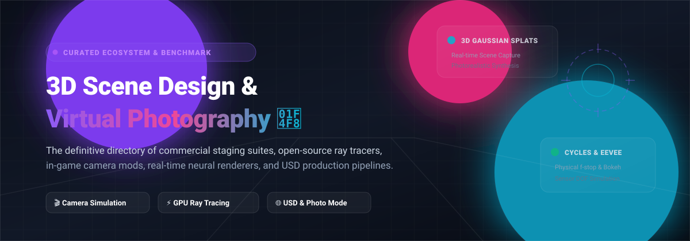

# Awesome-3D-Scene-Design-Virtual-Photography

  
  
  
  
  
  

### 🌟 Top 3D Scene Design & Virtual Photography Ecosystem 📸

**Curated Directory of SaaS Suites & Open-Source Projects for Virtual Camera Control, Ray Tracing & In-Game Capture**

*Empowering 3D artists, game photographers, VFX directors, and visualization engineers to master camera angles, sensor simulation, and render staging.*

---

## 📖 Table of Contents

- [🔭 Sector Overview & Market Dynamics](#-sector-overview--market-dynamics)
- [🏢 SaaS & Commercial Platforms](#-saas--commercial-platforms)
- [💻 Open-Source GitHub Projects](#-open-source-github-projects)
- [🌟 Star History](#-star-history)
- [🤝 How to Contribute](#-how-to-contribute)
- [💖 Support & Sponsorship](#-support--sponsorship)
- [⚖️ Disclaimer](#️-disclaimer)

---

## 🔭 Sector Overview & Market Dynamics

The global **3D rendering, scene staging, and visualization software market** is estimated between **$4.3B and $8.2B**, expanding rapidly at a **13–21% CAGR** driven by real-time ray tracing, neural radiance/Gaussian splatting capture, virtual film production, and spatial computing.

The sector exhibits **moderate fragmentation**:
- **Enterprise Core (Ecosystem Giants)**: A consolidated group of multi-billion dollar software leaders (**Adobe**, **Autodesk**, and **Dassault Systèmes**) govern foundational DCC, CAD, and automotive staging suites.
- **Specialized Engines & Innovators**: Independent firms (**Chaos**, **Luxion**, **Maxon**) command key architectural and product design niches.
- **Open-Source Vanguard**: Robust community-driven engines (**Blender**, **OpenUSD**, **3D Gaussian Splatting**) empower indie creators, researchers, and game developers with unrestricted, un-metered physical camera control.

---

## 🏢 SaaS & Commercial Platforms

A comprehensive comparison of leading commercial tools for scene staging, material composition, and virtual camera rendering:

| Product | Company Valuation / Revenue | Description | Pricing | Free Tier Limit |
| :--- | :--- | :--- | :--- | :--- |
| **[Adobe Substance 3D Stager](https://www.adobe.com/products/substance3d/apps/stager.html)** | **~$190B+ Market Cap** (~$21.5B Rev) | Scene assembly and virtual photography studio with lighting, materials, and camera controls. | **$49.99/mo** (billed annually at $599.88/yr) or **$59.99/mo** (month-to-month) for Substance 3D Collection; **$100/mo/seat** for Teams. | **30-day free trial** with full access to the Substance 3D Collection apps and 30 asset downloads/month. No permanent free tier. |
| **[Autodesk VRED](https://www.autodesk.com/products/vred/)** | **~$55B Market Cap** (~$5.5B Rev) | Automotive and product visualization software with advanced virtual camera and staging tools. | **$465/month** or **$3,730/year** (VRED Design single-user subscription); **~$7,117/year** (VRED Core). | **30-day free trial** of full functionality for non-commercial evaluation only (no extensions). No permanent free tier. |
| **[Cinema 4D](https://www.maxon.net/)** | **~$1.05B (€995M Rev)** *(Parent: Nemetschek)* | Professional 3D suite with Redshift GPU renderer, camera tools, and scene staging. | **$69.91/month** (billed annually at $839/yr) or **$109/month** (month-to-month); includes integrated Redshift and 5 Team Render nodes. | **14-day free trial** via Maxon App with full commercial toolset access. No permanent free tier. |
| **[KeyShot](https://www.keyshot.com/)** | **~$150M+ Valuation** (~$25M ARR, Luxion) | Real-time ray tracing renderer with camera, lighting, and material controls for product visualization. | **$108.25/month** (billed annually at $1,299/yr, KeyShot Studio Pro); **$133.25/month** ($1,599/yr, Studio Business). | **14-day free trial** of KeyShot Studio, restricted to 1 trial per machine per year; file saving and render queues disabled, outputs watermarked. No permanent free tier. |
| **[V-Ray (Chaos)](https://www.chaos.com/)** | **~$130M+ Est. ARR** *(PE: TA Associates)* | Industry-standard photorealistic renderer with physical camera controls (f-stop, shutter, ISO). | **$44.90/month** (billed annually at $538.80/yr) or **$84.90/month** (V-Ray Solo); **$62.90/mo** ($754.80/yr) for Premium. | **30-day free trial** with full access to Chaos Cloud and all V-Ray integrations. No permanent free tier. |
| **[Lumion](https://lumion.com/)** | **~€25M ARR** *(PE: Seven2 / Act-3D)* | Architectural rendering software with real-time visualization, camera effects, and a large asset library. | **$96/month** (billed annually at $1,149/yr, Pro Named-user); **$125/month** ($1,499/yr, Pro Floating). | **14-day free trial** (Lumion Pro Trial) with full feature access and reduced content library size, limited to 1 trial per PC. No permanent free tier. |
| **[Maxwell Render (Next Limit)](https://www.nextlimit.com/)** | **~$15M–$20M Est. Rev** *(Next Limit)* | Physically based renderer known for unbiased, photorealistic output and physical camera model. | **$995** one-time perpetual license (Standard node-locked); **$245** per additional Render Node. | **30-day demo trial** with node-locked license; exports watermarked and output resolution capped at 1280x1024. No permanent free tier. |
| **[Marmoset Toolbag](https://marmoset.co/)** | **~$2M–$3M Est. Rev** *(Marmoset LLC)* | Real-time rendering suite with camera, lighting, and presentation tools for virtual photography. | **$18.99/month** (monthly subscription) or **$399** one-time perpetual license for Individuals; **$49.99/mo/seat** or **$1,299** perpetual for Studios. | **30-day free trial** for personal evaluation (1 trial per user) with full rendering capabilities. No permanent free tier. |

---

## 💻 Open-Source GitHub Projects

Ranked in descending order by GitHub Stars ⭐. Each tool features open-source camera control, scene staging, physically based rendering, or photo mode integration:

1. **[3D Gaussian Splatting](https://github.com/graphdeco-inria/gaussian-splatting)**   
   **Real-time photorealistic radiance field capture and novel view synthesis.** Inria's seminal reference implementation that revolutionized virtual scene photography. Allows artists to turn sets of real-world or virtual multi-camera photos into navigable, continuous 3D scenes at interactive 1080p frame rates. Supports customizable camera trajectories, focal lengths, and virtual capture views.

2. **[Blender](https://github.com/blender/blender)**   
   **The premier open-source 3D suite with production-grade virtual camera simulation.** 100% free with zero feature restrictions. Features **Cycles** (path-traced photorealistic engine) and **EEVEE Next** (real-time GPU viewport) with true optical camera controls: f-stop aperture, shutter speed, ISO, custom bokeh blade counts and rotation, sensor dimensions, anamorphic ratio, and optical depth-of-field simulation.

3. **[OpenUSD (Universal Scene Description)](https://github.com/PixarAnimationStudios/OpenUSD)**   
   **Pixar's open-source 3D scene description standard.** The universal backbone for modern scene staging, lighting setup, and virtual cinematography interchange across DCC applications, Omniverse, and real-time game engines. Includes standardized camera schemas (`UsdGeomCamera`) with focal length, horizontal/vertical aperture, clipping range, and stereo camera definitions.

4. **[ArmorPaint](https://github.com/armory3d/armorpaint)**   
   **GPU-accelerated physically based texture painting software.** Standalone, node-based 3D painting application built with hardware ray-tracing acceleration. Perfect for creating hyper-realistic materials, micro-surface imperfections, and textures on assets before assembling them into virtual photography studios.

5. **[Mitsuba 3](https://github.com/mitsuba-renderer/mitsuba3)**   
   **Research-grade retargetable forward and inverse physically based renderer.** Developed at EPFL, Mitsuba provides an academically rigorous optical camera model, full polarized light transport simulation, spectral rendering, and automatic differentiation for inverse scene reconstruction and camera parameter optimization.

6. **[appleseed](https://github.com/appleseedhq/appleseed)**   
   **Modern physically based rendering engine for animation and visual effects.** Features a fully unbiased spectral path tracer with thin lens and physical camera models, depth of field, motion blur, Disney principled BSDFs, and native integrations for Blender and Maya.

7. **[OpenColorIO (OCIO)](https://github.com/AcademySoftwareFoundation/OpenColorIO)**   
   **The Academy Software Foundation's color management standard.** Essential for virtual photographers and digital cinematographers to maintain color fidelity across ACES, linear workflows, film looks, and HDR display targets from 3D viewport to final photo export.

8. **[LuxCoreRender](https://github.com/LuxCoreRender/LuxCore)**   
   **Unbiased physically based spectral renderer.** Designed for photorealistic visualization with physically correct camera simulation (realistic lens distortion, vignetting, bloom, sensor response, and chromatic aberration) seamlessly integrated into Blender.

9. **[PhotoMode for Unity](https://github.com/UnityTechnologies/PhotoMode)**   
   **Official Unity virtual photography package.** Provides an extensible in-engine screenshot framework equipped with free-flying camera rigs, focal depth simulation, artistic overlays, color grading, and rule-of-thirds composition aids.

10. **[CADRays](https://github.com/Open-Cascade-SAS/CADRays)**   
    **GPU-accelerated photorealistic ray tracer for CAD and industrial design.** Built on Open CASCADE Technology (OCCT) with real-time progressive path tracing. Features interactive viewport camera manipulation, physical perspective/orthographic modes, and direct STEP/BREP/OBJ model rendering.

11. **[Director's Suite](https://github.com/videotechuk/DirectorsSuite)**   
    **In-game cinematic photo studio and scene staging editor for Red Dead Redemption 2.** Advanced virtual photography mod with full free-cam orbit, physical depth of field, environmental light/weather control, 38 custom photographic filters, super-resolution lossless capture, and real-time prop spawning.

---

## 🌟 Star History

---

## 🤝 How to Contribute

Contributions from virtual photographers, 3D artists, game developers, and rendering engineers are very welcome! 🚀

1. 🍴 **Fork** the repository.
2. 🌿 Create a new feature branch (`git checkout -b feature/new-tool`).
3. 📝 Add or update the entry in `README.md` following the alphabetical / star-ranking format. Include:
   - Tool name and official repository/website link.
   - For open-source repos: include the `stargazers` badge (`?style=social&color=white`).
   - 1–2 sentence factual description detailing virtual camera, scene design, or staging capabilities.
4. ✅ Test links and ensure table markdown formatting remains clean.
5. 📬 Submit a **Pull Request** with a brief summary of the added tool.

---

## 💖 Support & Sponsorship

If you find this curated directory helpful for your 3D workflow, virtual photography sessions, or rendering pipelines, please consider supporting the project:

- ⭐ **Star this repository** to improve discoverability!
- 🍴 **Fork and share** with your network and creative communities.
- ☕ **Buy a coffee & sponsor**: Support ongoing research, maintenance, and open-source contributions directly on the [**GitHub Sponsors Dashboard**](https://github.com/sponsors/ishandutta2007).

Thank you for helping build an open, accessible, and camera-aware 3D creative community! 🎨📸

---

## ⚖️ Disclaimer

- This repository is a **community-curated collection** for educational and directory purposes; mentions do not constitute direct endorsements.
- **Blender** remains the only complete, fully featured 3D creation and camera simulation suite that is permanently 100% free and open-source without artificial licensing limits.
- **Pricing & Tier Verifications**: SaaS pricing plans, annual seat costs, and free trial constraints are tracked diligently as of October 2026. Please verify active terms on each vendor's official checkout before making enterprise commitments.

---

**Crafted with passion for virtual photographers, 3D artists, lighting leads, and digital filmmakers worldwide.** 🎬✨

